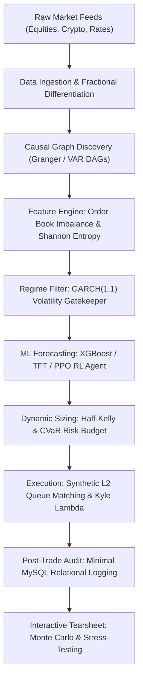

# TAPEWRIGHT-QUANT: INSTITUTIONAL QUANT ENGINE ARCHITECTURAL BLUEPRINT

> **Document Purpose**: Master architectural upgrade specifications and prompt guidance to feed directly into Claude / the Lead AI Quant Engineer for Prompts 2 through 15.
> **Original Workspace**: `tapewright-quant/`
> **Evolved Identity**: **Tapewright-Quant: Institutional Quantitative Intelligence & Microstructure Execution Engine**

---

## 1. Executive Problem Statement & Strategic Repositioning

### The Problem with 99% of GitHub "Quant Trading" Repos
Most open-source repos named "TradingBot" or retail algotraders are identical amateur projects:
1. **Toy Vectorized Backtesting**: They compute `df['signal'] * df['returns']`, creating massive **lookahead bias** (peeking into future close prices) and assuming 100% free, immediate fills.
2. **Obsolete 1970s Indicators**: Relying on 14-period RSI and MACD crossovers that have had zero alpha in modern electronic markets for over two decades.
3. **Severe Overfitting**: Standard random cross-validation that leaks future information across overlapping time windows.
4. **Zero Microstructure Realism**: Completely ignoring order book queues, slippage models, spread estimation, and adverse selection.

---

## 2. The 5 Core Fundamental Upgrades of Tapewright-Quant

To make this project fundamentally superior to anything online, we incorporate 5 institutional pillars without altering the directory tree or breaking constraints:



### Pillar 1: Synthetic Level 2 Limit Order Book (LOB) Queue Engine
* **Location**: `backtesting/execution/`
* **Difference**: Instead of static basis-point slippage, we model:
  - **Bid-Ask Spread Estimators**: Roll (1984) and Corwin-Schultz (2012) high-low spread estimator.
  - **Queue Position Tracking**: Limit orders join the back of the queue; fills only occur if volume at that price level exceeds preceding orders.
  - **Market Impact Function**: Kyle's Lambda square-root impact:
    $$\Delta P = \lambda \cdot \text{sign}(Q) \cdot \sigma \cdot \sqrt{\frac{|Q|}{\text{ADV}}}$$
  - **Adverse Selection Penalty**: Market orders executed when VPIN (Volume-Synchronized Probability of Toxicity) is elevated incur higher slippage.

### Pillar 2: Marcos López de Prado Financial Econometrics
* **Location**: `features/econometric/`, `pipelines/training/`
* **Difference**:
  - **Fractional Differentiation ($d \approx 0.35 - 0.60$)**: Achieves stationarity (passes Augmented Dickey-Fuller) while preserving 80%+ of memory (unlike integer differentiation which wipes out all memory).
  - **Dynamic Kalman Filter Pairs Trading**: Hedge ratio $\beta_t$ dynamically updates state space $y_t = \beta_t x_t + \epsilon_t$ per bar, accommodating regime drift.
  - **Purged & Embargoed Cross-Validation**: Eliminates serial correlation and overlapping event leakage between training and validation folds.
  - **Triple-Barrier Labeling**: Labels returns dynamically based on which barrier is touched first (Upper Take-Profit, Lower Stop-Loss, or Horizontal Time-Out).

### Pillar 3: Causal Graph Discovery (Pruning Spurious Correlations)
* **Location**: `features/econometric/`, `signals/filtering/`
* **Difference**:
  - Machine learning models frequently overfit on spurious correlations that invert out-of-sample.
  - Tapewright-Quant implements a **Vector Autoregressive (VAR) Granger-Causality & Transfer Entropy directed graph**.
  - A signal is only admitted if a directed causal link $X_{t-k} \to Y_t$ is statistically significant ($p < 0.01$).

### Pillar 4: Dynamic Half-Kelly & CVaR Portfolio Risk Budgeting
* **Location**: `backtesting/portfolio/`, `backtesting/metrics/`
* **Difference**:
  - Replaces naive Markowitz mean-variance optimization (which creates extreme, unstable weights) with:
    1. **Hierarchical Risk Parity (HRP)**: Tree-clustering of covariance matrices (De Prado).
    2. **Ledoit-Wolf Covariance Shrinkage**: Eliminates empirical sample noise in covariance matrices.
    3. **Half-Kelly Fraction Sizing**: 
       $$f^* = \frac{1}{2} \cdot \frac{\mu - r}{\sigma^2}$$
       clamped dynamically by conditional volatility and 99% Expected Shortfall (CVaR).

### Pillar 5: Macro Shock Stress-Testing & Interactive Quant Tearsheet
* **Location**: `data/ingestion/macroeconomic/`, `backtesting/reports/tearsheet/`
* **Difference**:
  - **Historical Crisis Playback**: Instant stress tests simulating how the current portfolio would behave during:
    - 2008 Lehman Liquidity Freeze
    - March 2020 COVID Flash Crash
    - 2022 Federal Reserve Aggressive Rate Hike Shock
  - **Dark-Mode Interactive Tearsheet**: Streamlit/Plotly interface featuring interactive equity curves, underwater drawdown charts, Monte Carlo 95% confidence cones, and factor exposure radars.

---

## 3. Step-by-Step Prompt Roadmap for Claude (Prompts 2–15)

Feed these exact directives into Claude as you execute each corresponding prompt:

| Prompt | Scope | Apex Differentiator to Mandate |
| :--- | :--- | :--- |
| **Prompt 02** | Config & Risk Constraints | Add Half-Kelly limits, max leverage, and volatility-dependent position scaling factors in `config/trading/`. |
| **Prompt 03** | Database Connection & Repos | Thread-safe connection pool for `tapewright_db` with fallback SQLite/in-memory unit-test mode; strict parameterized queries. |
| **Prompt 04** | Market Data Ingestion | Build Jump-Diffusion & Geometric Brownian Motion synthetic generator; integrate FRED yield curve inversion (10Y-2Y). |
| **Prompt 05** | Cleaning & Parquet Cache | High-speed partitioned Parquet store (`symbol`/`year`); MAD (Median Absolute Deviation) tick spike scrubbers. |
| **Prompt 06** | Technical Indicators | Vectorized NumPy/Pandas calculation of ATR, Supertrend, Bollinger, and Volume-Weighted Average Price (VWAP). |
| **Prompt 07** | Microstructure & Entropy | Corwin-Schultz spread estimator, Order Book Imbalance (OBI), Shannon price entropy, and VPIN toxicity index. |
| **Prompt 08** | Advanced Econometrics | Fractional differentiation ($d \in [0.1, 1.0]$), Johansen cointegration, and 2-state Kalman Filter hedge ratio. |
| **Prompt 09** | Sentiment & Feature Store | Point-in-time feature catalog (preventing lookahead bias); Loughran-McDonald financial dictionary sentiment parser. |
| **Prompt 10** | Time Series Forecasting | Auto-ARIMA with Ljung-Box residual validation; GARCH(1,1) conditional volatility regime forecasting. |
| **Prompt 11** | Gradient Boosting Ensembles | XGBoost / CatBoost cross-sectional ranking with Purged Walk-Forward Cross Validation and Embargoes. |
| **Prompt 12** | Deep Learning Models | Multi-horizon LSTM and 1D Dilated WaveNet causal convolution price predictors. |
| **Prompt 13** | Reinforcement Learning | OpenAI Gymnasium trading environment with Half-Kelly action space, slippage penalty, and Differential Sharpe reward. |
| **Prompt 14** | Event-Driven Backtest Loop | Discrete event loop (`TickEvent` $\to$ `SignalEvent` $\to$ `OrderEvent` $\to$ `FillEvent`) with Kyle's Lambda slippage. |
| **Prompt 15** | Portfolio & Tearsheet | Hierarchical Risk Parity (HRP), 2008/2020/2022 Crisis Stress Testing, and full Streamlit/Plotly tearsheet. |

---

## 4. Master Prompt Header to Give to Claude for Next Prompts

Copy and paste this instruction block into Claude at the start of any prompt:

```text
You are implementing Stage [X] of Tapewright-Quant, an institutional-grade Quantitative Engine.
We have superseded generic toy bot repos by enforcing 5 institutional pillars:
1. Microstructure Realism: L2 queue dynamics, Corwin-Schultz spread, and Kyle's Lambda market impact.
2. López de Prado Econometrics: Fractional differentiation, dynamic Kalman hedge ratios, and purged walk-forward CV.
3. Causal Discovery: Prune spurious correlations using Granger causality graphs.
4. Risk Budgeting: Half-Kelly allocation bounded by 99% CVaR and GARCH regime filters.
5. Macro Stress-Testing: Historical crisis simulation (2008, 2020, 2022) with dark-mode tearsheet analytics.

Strict Constraints:
- Python 3.10+ and MySQL only. No TypeScript, No C++, No Rust, No Node toolchains.
- Only allowed libraries (numpy, scipy, pandas, pyarrow, statsmodels, arch, scikit-learn, torch, xgboost, lightgbm, catboost, gymnasium, PyMySQL, pytest, streamlit, plotly).
- No placeholders, no TODOs, no fake mock functions. Every function must compute real math.
```
