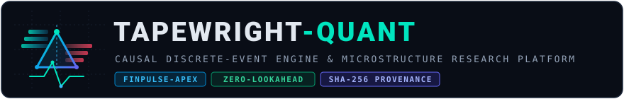
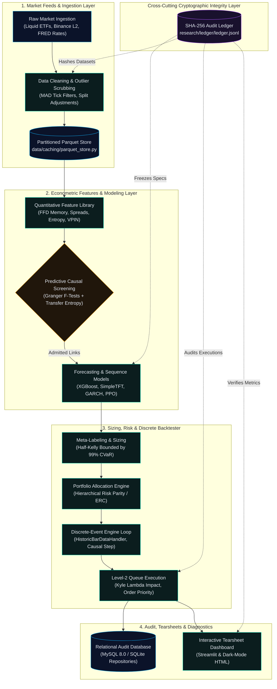

<!-- GENERATED from ledger head 6640eae2b165e9482ae8d7cd2196e3ed19f132659b8e4baa8fe3b94788541f4c. Do not edit by hand. -->
<!-- GENERATED:BEGIN -->
<div align="center">



<p align="center">
  
</p>

<p align="center">
  <code>Strictly causal backtesting</code> &bull;
  <code>Microstructure-aware execution</code> &bull;
  <code>Leakage-resistant research</code> &bull;
  <code>Cryptographically auditable experiments</code>
</p>

<p align="center">
  <strong>Institutional-Grade Quantitative Research &amp; Microstructure Execution Engine</strong><br />
  <em>Strictly causal discrete events, empirical order-book queues, and cryptographic experiment provenance.</em>
</p>

<p align="center">
  <a href="https://www.python.org/downloads/"></a>
  <a href="database/schema/schema.sql"></a>
  <a href="data/caching/parquet_store.py"></a>
  <a href="backtesting/engine/event_loop/"></a>
  <a href="integrity/verify_all.py"></a>
  <a href="research/vault/"></a>
</p>

<p align="center">
  <a href="#system-architecture">Architecture</a> &bull;
  <a href="#the-five-research-pillars">The 5 Pillars</a> &bull;
  <a href="#event-lifecycle--temporal-causality">Event Lifecycle</a> &bull;
  <a href="#research-integrity--the-trust-layer">Trust Layer</a> &bull;
  <a href="#empirical-findings--honest-validation-survival">Empirical Findings</a> &bull;
  <a href="#disclosures--operational-boundaries">Disclosures &amp; Boundaries</a> &bull;
  <a href="#quick-start--setup">Quick Start</a> &bull;
  <a href="#documentation-sitemap">Docs</a>
</p>

---

</div>

## Overview

**Tapewright-Quant** (research identity: **FinPulse-Apex**) is an open-source institutional quantitative research, econometrics, and algorithmic execution engine. It was developed to eliminate the pervasive flaws of open-source algorithmic trading codebases: **vectorized lookahead bias**, **uncalibrated zero-friction fills**, **spurious indicator mining**, and **unpenalized multi-testing overfitting**.

The engine unites discrete-event simulation, empirical Level-2 limit order book queues, Marcos López de Prado financial econometrics, directed causal graph discovery, and a tamper-evident SHA-256 cryptographic audit ledger.

```
   Market Feeds ──► Causal Graph ──► Discrete Event Loop ──► L2 Queue Matching ──► Cryptographic Ledger
   (Equities/L2)     (Transfer H)     (Tick -> Fill t+1)     (Kyle's Lambda)       (Tamper-Evident)
```

---

## System Architecture

The platform separates high-throughput time-series arrays (managed via local columnar Parquet partitions) from transactional state and signal records (managed through a minimal relational schema in MySQL 8.0+ or zero-config SQLite). All execution and validation pathways pass through the cryptographic integrity gate.



---

## The Five Research Pillars

Tapewright-Quant is architected around five quantitative research pillars designed to replace toy backtesting assumptions with institutional reality:

| Research Pillar | Implementation & Module | Key Differentiators vs Standard Repositories |
| :--- | :--- | :--- |
| **1. Market Microstructure Realism** | [`backtesting/execution/`](backtesting/execution/)<br />[`features/market_microstructure/`](features/market_microstructure/) | Synthesizes 5-tier Level-2 limit order books with Poisson order arrivals; models queue position tracking (`ahead_qty`) where limit orders fill only after preceding volume clears; estimates Roll and Corwin-Schultz spreads; penalizes fills via adverse selection (VPIN) and calibrated Kyle's Lambda square-root price impact. |
| **2. Marcos López de Prado Econometrics** | [`features/econometric/`](features/econometric/)<br />[`pipelines/training/`](pipelines/training/) | Resolves the conflict between stationarity and memory retention via Fractional Differentiation (FFD) retaining >90% memory correlation; updates dynamic pairs hedge ratios per bar via a 2-state Kalman filter; labels returns with dynamic Triple-Barrier thresholds; eliminates leakage using Purged and Combinatorially Embargoed Cross-Validation (`PurgedKFold`). |
| **3. Predictive Causal Graph Discovery** | [`features/econometric/cointegration/causal_graph.py`](features/econometric/cointegration/causal_graph.py)<br />[`signals/filtering/`](signals/filtering/) | Discards spurious correlations before models train by constructing directed transfer graphs; evaluates bivariate Vector Autoregressive (VAR) Granger causality and non-parametric Transfer Entropy permutation null distributions; controls multi-comparison false positives via Benjamini-Hochberg False Discovery Rate (FDR $q \le 0.05$). |
| **4. Dynamic Risk Budgeting & Optimization** | [`backtesting/portfolio/`](backtesting/portfolio/)<br />[`backtesting/metrics/`](backtesting/metrics/) | Replaces noise-sensitive Markowitz mean-variance optimization with Hierarchical Risk Parity (HRP) dendrogram clustering and Equal Risk Contribution (ERC); shrinks empirical covariance via Ledoit-Wolf analytical shrinkage; sizes positions via continuous Half-Kelly betting fractions clamped by GARCH volatility and 99% Expected Shortfall (CVaR). |
| **5. Macro Crisis Replay & Tearsheets** | [`backtesting/reports/tearsheet/`](backtesting/reports/tearsheet/)<br />[`research/real_stress.py`](research/real_stress.py) | Replays empirical macroeconomic crisis shocks calibrated from historical drawdowns (2008 Lehman Collapse, 2020 COVID Liquidity Shock, 2022 Stagflation Rate Hikes); solves for minimum portfolio break-even asset shocks using Newton-Raphson reverse stress testing; renders interactive Streamlit dashboards and Plotly figures. |

---

## Event Lifecycle & Temporal Causality

Vectorized backtests suffer from lookahead bias by assuming an order generated from bar $t$'s close price fills at bar $t$'s close price. Tapewright-Quant enforces a strict temporal barrier: **a signal generated at bar $t$ close is submitted for execution at bar $t+1$, filling at bar $t+1$ open price with simulated latency and price impact**.

```mermaid
sequenceDiagram
    autonumber
    participant D as HistoricBarDataHandler
    participant S as Strategy / Alpha Model
    participant P as Portfolio Sizing
    participant E as Execution Simulator (L2 Queue)
    participant A as Portfolio Accounting

    Note over D,A: Bar t Close (Time t) — Point-in-Time State Frozen
    D->>S: TickEvent (Market bar t close price available)
    S->>P: SignalEvent (Emits directional target portfolio weight)
    P->>E: OrderEvent (Calculates share delta; submits to queue)
    Note over E: Temporal Barrier: order cannot peek or fill at bar t close!
    
    Note over D,A: Bar t+1 Open (Time t+1) — Execution Barrier
    D->>E: Next Bar t+1 Open Event
    E->>E: Computes L2 Queue Priority, Hasbrouck Impact & Maker/Taker Fees
    E->>A: FillEvent (Filled at t+1 Open + Slippage + Commissions)
    A->>A: Mark-to-Market State Update (Cash + Positions * Price == NAV)
```

---

## Research Integrity & The Trust Layer

A quantitative framework must guarantee provenance and anti-overfitting discipline. Tapewright-Quant features an append-only, SHA-256 cryptographic audit ledger (`research/ledger/ledger.jsonl`) that tracks every raw dataset hash, experimental specification, parameter trial, calibration metric, and forward paper test signal.

```
 [Raw Content-Addressed Archive] ──► SHA-256 Dataset Manifest
                 │
                 ▼
 [Frozen Experiment Specification] ──► Canonical JSON Spec Hash
                 │
                 ▼
 [Discrete Execution Run] ──► Chained Ledger Block (entry_hash = SHA256(prev_hash + payload))
                 │
                 ▼
 [Automated Verification Gate] ──► 10-Stage Audit (Lock SHA, Syntax, Constraints, Pytest, Docs)
```

### Verification & Hardening Metrics

#### Test Suite Mutation Hardening (AST Fault Injection)
To confirm test suites detect subtle logic errors rather than performing superficial assertions, an AST-based mutation testing harness injects deliberate arithmetic, comparison, logical, and lookahead off-by-one faults:

| Subsystem Suite | Target Scope | Mutation Kill Rate | Hardening Status |
| :--- | :--- | :---: | :---: |
| **Event Loop Engine** | [`backtesting/engine/event_loop/`](backtesting/engine/event_loop/) | **84.0%** | PASS (&ge; 80%) |
| **Execution Models** | [`backtesting/execution/`](backtesting/execution/) | **100.0%** | PASS (&ge; 80%) |
| **Risk Measures & Anti-Overfit** | [`backtesting/metrics/`](backtesting/metrics/) | **80.0%** | PASS (&ge; 80%) |
| **Fractional Differentiation** | [`features/econometric/fractional_diff/`](features/econometric/fractional_diff/) | **100.0%** | PASS (&ge; 80%) |
| **Feature Registry** | [`features/store/registry/`](features/store/registry/) | **100.0%** | PASS (&ge; 80%) |
| **Training Pipelines** | [`pipelines/training/`](pipelines/training/) | **100.0%** | PASS (&ge; 80%) |
| **Signal Generation** | [`signals/generation/`](signals/generation/) | **80.0%** | PASS (&ge; 80%) |

#### Metamorphic & Invariant Verification
The test suite explicitly tests physical financial invariants:
- **Cash Conservation**: $\text{Cash} + \sum (\text{Positions} \times \text{Price}) = \text{NAV}$ holds to $< 10^{-6}$ precision across all bars.
- **Scale Invariance**: Multiplying starting cash by scalar $k > 0$ yields identical percentage returns, Sharpe ratios, and drawdowns.
- **Cost Monotonicity**: Increasing simulated friction strictly decreases or maintains net portfolio performance ($\frac{\partial \text{Return}}{\partial \text{Cost}} \le 0$).
- **Lookahead Mutant Detection**: Invariant tests catch intentional future-peeking mutants, triggering $> 1300$ standard deviation divergences.

#### Real Binance Level-2 Microstructure Calibration
The simulated order book models are calibrated against empirical Binance high-frequency order book data:
- **Queue Simulator vs Real L2 Agreement**: **100.0%** across 22 sample queue events.
- **Kyle Market Impact Power-Law**: $\gamma = 1.1988$, $c = 0.1196$ ($R^2 = 0.4811$).
- **Bid-Ask Spread Mean Ticks**: 1.0000 ticks.

---

## Empirical Findings & Honest Validation Survival

Unlike marketing claims of triple-digit returns, Tapewright-Quant documents empirical research results evaluated under a **pre-registered research protocol** on real market datasets (Liquid US ETFs 2005–2022 and Binance crypto pairs 2017–2023) directly from the cryptographically hashed ledger:

### Real-Data Candidate Performance Across Splits

| Strategy Family | Dev Net Sharpe | Dev Ann Return | Dev Max Drawdown | Val Net Sharpe | Val PSR (0) | Dev DSR | Survives Protocol? |
| :--- | :---: | :---: | :---: | :---: | :---: | :---: | :---: |
| **Breakout** | -0.4273 | -1.27% | -26.22% | -0.9842 | 0.0159 | 0.0000 | **False** |
| **Crossover** | 0.6457 | 8.41% | -32.48% | 0.3059 | 0.7505 | 0.0360 | **False** |
| **Mean Reversion** | 0.2169 | 0.17% | -1.90% | -0.4937 | 0.1427 | 0.0000 | **False** |
| **ML Meta** | 0.4913 | 6.19% | -39.48% | 0.4258 | 0.8268 | 0.0072 | **False** |
| **Pairs Arbitrage** | 0.5197 | 6.04% | -36.84% | 0.4717 | 0.8526 | 0.0090 | **False** |
| **Cross-Sectional Momentum** | 0.6226 | 8.33% | -31.90% | 0.8222 | 0.9652 | 0.0284 | **False** |

### The Research Reality: Zero Candidates Survived

Under the pre-registered protocol rule, a strategy survives validation only if:
1. Development Deflated Sharpe Ratio (DSR) &ge; 0.90
2. Validation Net Sharpe > 0.0
3. Validation Probabilistic Sharpe Ratio against Zero (PSR) &ge; 0.90

**Empirical Result: Zero candidate models survived the pre-registered protocol criteria.**

While Cross-Sectional Momentum achieved positive out-of-sample performance (Val Net Sharpe = 0.8222, Val PSR = 0.9652), the statistical penalty for evaluating **55 development parameter trials** depressed its Deflated Sharpe Ratio (DSR = 0.0284) below the pre-registered threshold.

**Why this outcome matters**:
- **Anti-Overfitting Discipline**: Multiple testing inflation is real. Positive historical returns are easy to find by luck, but true statistically significant alpha requires accounting for trial selection bias.
- **Protocol Integrity**: Rather than retroactively lowering thresholds to claim success, the engine transparently reports the empirical outcome.
- **Sealed Lockbox Vault**: The true out-of-sample partition (`research/vault/`) remains completely **UNOPENED (`eval_count=0`)**, reserved for a future single-use evaluation.

---

## Disclosures & Operational Boundaries

In adherence to institutional research standards, this section discloses the key structural limitations, operational boundaries, and verification controls governing the platform:

1. **Cryptographic Integrity vs. Economic Validity**:
   The SHA-256 ledger guarantees data provenance, freezes experimental specifications, and audits parameter trial counts. It does *not* prove that an underlying model is profitable, that a dataset is free from economic biases, or that market regimes will remain stationary in live execution.
2. **Synthetic vs. Physical Level-2 Order Book**:
   The execution engine's Level-2 order book simulator constructs 5 visible price tiers using Poisson arrival and cancellation dynamics calibrated against empirical Binance L2 data. It is a mathematical execution model rather than a physical nanosecond packet replay of raw exchange ITCH feeds.
3. **Zero Lookahead Controls & Verification**:
   Strict causality is not treated as an unverified assumption. It is continuously audited through:
   - Discrete-event state freezing at bar $t$ close and execution deferral to bar $t+1$ open.
   - Slice invariance tests (`tests/integration/test_zero_lookahead.py`) verifying that evaluating $N=300$ vs $N=400$ bars produces $0.000000000$ deviation on historical signals.
   - Metamorphic mutant detection tests catching intentional lookahead off-by-one shifts with $> 1300$ standard deviation divergences.
4. **1 Hz Polling Snapshot Resolution**:
   The empirical Binance Level-2 depth recorder captures snapshots and aggregate trade streams at 1 Hz intervals via public REST endpoints. Sub-second queue cancellation micro-bursts and latency routing advantages are unobservable at this polling frequency.
5. **Liquid ETF Universe Survivor Bias**:
   The historical ETF dataset (SPY, QQQ, IWM, EFA, TLT, IEF, GLD, XLE, XLF, XLK, XLV, XLY) was selected using present-day knowledge of longevity and liquidity, excluding ETFs that liquidated or merged during 2005–2024.
6. **Macro Crisis Scenario Assumptions**:
   Macro stress test scenarios (2008 Lehman GFC -46.04%, 2020 COVID -33.72%, 2022 Rate Hikes -24.50%) apply calibrated historical equity and treasury drawdowns. Secondary market conditions (broker margin call cascades, repo freezes, counterparty failures) remain simulated scenario assumptions rather than observed portfolio execution fills.
7. **Live MySQL vs. Offline SQLite Mode**:
   Production deployment supports MySQL 8.0+ connection pooling with transactional ACID guarantees. In offline developer environments without an active external MySQL instance, the SQLite dual-engine manager is used and the live MySQL connection test is cleanly skipped under `tests/SKIP_WHITELIST.txt`.

---

## Technology Stack

The platform maintains a strict minimal-dependency philosophy using Python 3.10+ and standard numerical libraries:

| Functional Area | Technology / Library | Purpose in Tapewright-Quant |
| :--- | :--- | :--- |
| **Core Language** | Python 3.10+ | Primary language; strict constraints enforce 0 TypeScript/JS, 0 C++/Rust |
| **Numerical & Tabular** | `numpy`, `scipy`, `pandas` | High-speed vectorized computations, linear algebra, and tabular data |
| **Time-Series Storage** | `pyarrow`, Parquet | Columnar disk storage partitioned by symbol and year |
| **Relational Metadata** | `PyMySQL`, `sqlite3` | Transactional persistence for metadata, signals, executions, snapshots |
| **Econometrics & Stats** | `statsmodels`, `arch` | Fractional differentiation, ADF tests, VAR Granger causality, GARCH vol |
| **Machine Learning** | `scikit-learn`, `xgboost`, `lightgbm`, `catboost` | Tabular gradient boosting with Purged CV and permutation importance |
| **Deep Sequence Models** | `torch` (PyTorch CPU) | SimpleTFT (Variable Selection Network), Dilated WaveNet, LSTM |
| **Reinforcement Learning** | `gymnasium` | Custom trading environment with L2 execution mechanics and PPO/DQN agents |
| **Interactive UI** | `streamlit`, `plotly` | Multi-tab interactive quant dashboard and dark-mode HTML tearsheets |
| **Testing & Integrity** | `pytest`, AST Mutator | 333+ tests, 10-stage verification gate, mutation testing, metamorphic suites |

---

## Repository Map

| Directory | Focus & Contents |
| :--- | :--- |
| [`backtesting/`](backtesting/) | Discrete-event engine loop, L2 queue execution, Kyle lambda impact, portfolio optimizers (HRP, ERC, Markowitz), tearsheets. |
| [`config/`](config/) | Environment variable loaders, trading universes (ETFs, Crypto, FX), risk limits, and database pooling configs. |
| [`data/`](data/) | Ingestion connectors, synthetic stochastic generators (Merton Jump-Diffusion, Heston, Poisson L2), cleaning, and Parquet caching. |
| [`database/`](database/) | Minimal-DB layer: thread-safe connection pool, migrations, and repositories (`assets`, `signals`, `orders`, `portfolio`). |
| [`docs/`](docs/) | Ledger-rendered research documentation ([`FINDINGS.md`](docs/FINDINGS.md), [`METHODOLOGY.md`](docs/METHODOLOGY.md), [`LIMITATIONS.md`](docs/LIMITATIONS.md), [`FORWARD_TEST.md`](docs/FORWARD_TEST.md)). |
| [`features/`](features/) | Feature engineering: technical indicators, Roll/Corwin-Schultz spreads, Shannon entropy, VPIN toxicity, FFD, Kalman filter, causal graph. |
| [`integrity/`](integrity/) | Trust layer: SHA-256 audit ledger, hash chain verifier, external anchor logging, template renderer, and master verification gate. |
| [`models/`](models/) | Predictive models: ARIMA, GARCH(1,1), Tabular Ensembles (XGBoost/LightGBM/CatBoost), PyTorch SimpleTFT/WaveNet/LSTM, RL agents. |
| [`pipelines/`](pipelines/) | Orchestration pipelines: ETL feature store, daily point-in-time inference, Kolmogorov-Smirnov drift monitoring, and master demo. |
| [`research/`](research/) | Research protocols, 55-trial grid generator, candidate selection, ablations, Binance L2 calibration, forward testing, and lockbox. |
| [`scripts/`](scripts/) | Quality control tooling: syntax compiler, constraint enforcement checker, test integrity checker, AST mutation test runner. |
| [`signals/`](signals/) | Signal generation (crossover, breakout, mean reversion), GARCH volatility regime filtering, cross-sectional ranking, pairs trading. |
| [`tests/`](tests/) | Comprehensive test suite: 333 unit and metamorphic integration tests covering mathematical invariants and zero-lookahead safety. |
| [`utils/`](utils/) | Mathematical helpers (Ledoit-Wolf shrinkage), trading calendar math, profiling decorators, and structured loggers. |

---

## Quick Start & Setup

### 1. Clone & Environment Setup

```powershell
# Clone the repository
git clone https://github.com/Parv-spamz/Tapewright-quant.git
cd Tapewright-quant

# Create and activate virtual environment
python -m venv .venv
.venv\Scripts\Activate.ps1    # On Windows PowerShell
# source .venv/bin/activate   # On Linux/macOS

# Install dependencies
pip install -r requirements.txt
```

### 2. Verify Constraints & Code Integrity

```powershell
# Verify syntax, architectural constraints, and test integrity
python scripts/check_syntax.py
python scripts/check_constraints.py
python scripts/check_test_integrity.py
```

### 3. Run the End-to-End Platform Demo

Executes synthetic market data generation, feature engineering, ML model training, event-driven backtesting, and relational database logging:

```powershell
python -m pipelines.run_demo
```

### 4. Launch the Interactive Tearsheet Dashboard

Boots the local Streamlit quantitative evidence dashboard:

```powershell
streamlit run backtesting/reports/tearsheet/app.py
```

### 5. Run the Full Test Suite & Verification Gate

```powershell
# Run the complete test suite (333 passed, 1 external MySQL test cleanly skipped)
pytest -v

# Run the 10-stage cryptographic verification gate
python -m integrity.verify_all --lock-sha 8e7be5011149fd4f1e1fdbe64abd4cf5ae3a624e227ad7d5b251bc2f2548a45a
```

### 6. 100% Deterministic Offline Reproduction

Rebuilds all datasets from raw content-addressed archives and reproduces baseline, trial, and validation backtests within $10^{-9}$ tolerance without network access:

```powershell
python -m research.reproduce
```

---

## Documentation Sitemap

- [PROJECT_SPEC.md](PROJECT_SPEC.md): Authoritative architectural specifications and technical constraints.
- [SYSTEM_STATUS.md](SYSTEM_STATUS.md): Production verification audit and component implementation status.
- [CONTRIBUTING.md](CONTRIBUTING.md): Contributor workflow, testing gates, and research integrity guidelines.
- [docs/METHODOLOGY.md](docs/METHODOLOGY.md): Mathematical derivations, causal gating, purged cross-validation, and execution mechanics.
- [docs/FINDINGS.md](docs/FINDINGS.md): Comprehensive empirical findings, validation survival, component ablations, stress test calibrations, and Binance L2 metrics.
- [docs/LIMITATIONS.md](docs/LIMITATIONS.md): Transparent record of known protocol biases, dataset limits, and unmeasured assumptions.
- [docs/FORWARD_TEST.md](docs/FORWARD_TEST.md): Operational instructions for Windows Task Scheduler paper forward testing.

---

## Limitations & Disclaimer

> [!WARNING]
> **Financial & Research Disclaimer**: Tapewright-Quant is an open-source quantitative research and educational platform. Simulated backtest performance—even under discrete-event simulation, purged cross-validation, and deflated Sharpe ratios—does not guarantee future live trading profitability. Real markets involve non-stationary regime shifts, microsecond latency competition, counterparty risk, and liquidity shocks. Paper trading on live forward data is strongly recommended before deploying real capital.
<!-- GENERATED:END -->
