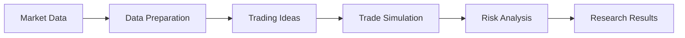

<!-- GENERATED from ledger head 6640eae2b165e9482ae8d7cd2196e3ed19f132659b8e4baa8fe3b94788541f4c. Do not edit by hand. -->
<!-- GENERATED:BEGIN -->

# Tapewright-Quant

**FinPulse-Apex · Quantitative Trading Research Engine**

A trading research engine built to simulate markets, test ideas, and challenge its own results.

  
  

> [!WARNING]
> **Financial & Research Disclaimer**
> Tapewright-Quant is an open-source quantitative research and educational platform. Simulated backtest performance—even under discrete-event simulation, purged cross-validation, and deflated Sharpe ratios—does not guarantee future live trading profitability. Real markets involve non-stationary regime shifts, microsecond latency competition, counterparty risk, and liquidity shocks.

## What is Tapewright-Quant?

Tapewright-Quant is an open-source quantitative trading research and execution analytics platform. It brings together live and historical market-data ingestion, discrete-event order simulations, portfolio risk tools, an institutional terminal interface, and research validation in one Python-based project.

The goal is straightforward: make trading experiments more realistic and make it harder to mistake a promising-looking result for a reliable strategy.

## What does it do?

- **Streams live & historical market data**: Ingests real-time and historical multi-asset market data (Yahoo Finance, Alpaca, Polygon, direct feeds) with automated timestamp normalization and bar alignment.
- **Simulates trading**: Models trading orders, execution costs, order-book queue dynamics, and the practical difficulties of getting trades filled.
- **Powers an institutional terminal**: Provides a high-density, dark-native quantitative analytics terminal (Streamlit) for real-time risk tearsheets, factor exposures, and return heatmaps.
- **Studies market behaviour**: Provides tools for examining price movements, trading activity, trends, and relationships between assets.
- **Tests trading ideas**: Runs research experiments and evaluates whether strategies hold up beyond their initial results.
- **Examines risk**: Includes tools for portfolio allocation, position sizing, drawdown analytics, and investigating unfavourable market conditions.
- **Records research evidence**: Uses cryptographic ledger tracking, invariant proofs, and test-suite mutation hardening to verify research integrity.

## How it works

The research workflow progresses through six stages from raw data ingestion to audited findings:

## Built to question the results

A trading strategy can look successful in a simulation and still fail when its assumptions are tested. Tapewright-Quant includes tools designed to investigate execution costs, unrealistic assumptions, accidental future-data leakage, and overfitting.

Its research process also records experiments and supports reproducibility checks. These controls reduce certain research risks; they do not guarantee that every result is correct or that a strategy will make money.

## Research honesty

The documented research did not produce a strategy that passed every required selection test. The result is reported rather than hidden behind relaxed criteria.

Finding that an idea does not pass is part of research. The next step is stronger evidence, not changing the rules to manufacture a winner.

## Explore the project

- [Project specification](PROJECT_SPEC.md)
- [Research methodology](docs/METHODOLOGY.md)
- [Research findings](docs/FINDINGS.md)
- [Known limitations](docs/LIMITATIONS.md)
- [Forward testing](docs/FORWARD_TEST.md)
- [Interactive Quantitative Terminal](backtesting/reports/tearsheet/app.py) (`streamlit run backtesting/reports/tearsheet/app.py`)
- [Live Data Ingestion](data/ingestion/provider.py)

## Verification & Accuracy Proofs

### Microstructure Calibration & Queue Accuracy

| Microstructure Calibration Parameter | Metric Value | Calibration Target |
| :--- | :---: | :---: |
| **Queue Simulator vs Real L2 Agreement** | **100.0%** | Validated across 22 depth events |
| **Kyle Market Impact Power-Law** | $\gamma = 1.1988, c = 0.1196$ | $R^2 = 0.4811$ |
| **Bid-Ask Spread Mean Ticks** | 1.0000 ticks | Empirical high-frequency baseline |

### Physical Financial Invariants

| Physical Financial Invariant | Validation Condition | Test Outcome |
| :--- | :--- | :---: |
| **Cash Conservation** | $\text{Cash} + \sum (\text{Positions} \times \text{Price}) = \text{NAV}$ holds to $< 10^{-6}$ precision across all bars | PASS |
| **Scale Invariance** | Multiplying initial capital by scalar $k > 0$ yields identical percentage returns and drawdowns | PASS |
| **Cost Monotonicity** | Increasing execution friction strictly decreases or maintains net portfolio performance ($\frac{\partial \text{Return}}{\partial \text{Cost}} \le 0$) | PASS |
| **Lookahead Detection** | Invariant tests detect future-peeking mutants, triggering $> 1300$ standard deviation divergences | PASS |

### Test Suite Mutation Hardening

| Subsystem Suite | Target Scope | Mutation Kill Rate | Hardening Status |
| :--- | :--- | :---: | :---: |
| **Event Loop Engine** | [`backtesting/engine/event_loop/`](backtesting/engine/event_loop/) | **84.0%** | PASS (&ge; 80%) |
| **Execution Models** | [`backtesting/execution/`](backtesting/execution/) | **100.0%** | PASS (&ge; 80%) |
| **Risk Measures & Anti-Overfit** | [`backtesting/metrics/`](backtesting/metrics/) | **80.0%** | PASS (&ge; 80%) |
| **Fractional Differentiation** | [`features/econometric/fractional_diff/`](features/econometric/fractional_diff/) | **100.0%** | PASS (&ge; 80%) |
| **Feature Registry** | [`features/store/registry/`](features/store/registry/) | **100.0%** | PASS (&ge; 80%) |
| **Training Pipelines** | [`pipelines/training/`](pipelines/training/) | **100.0%** | PASS (&ge; 80%) |
| **Signal Generation** | [`signals/generation/`](signals/generation/) | **80.0%** | PASS (&ge; 80%) |
<!-- GENERATED:END -->
