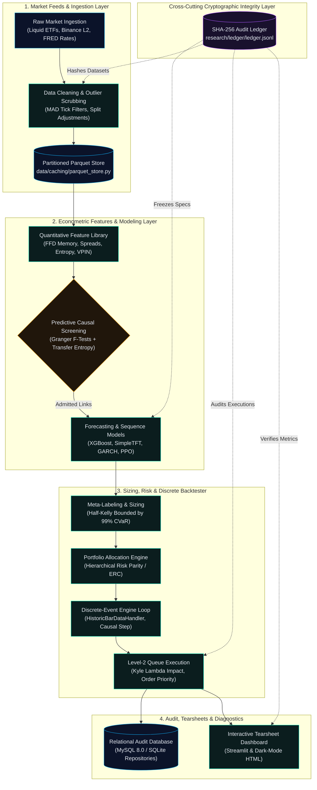
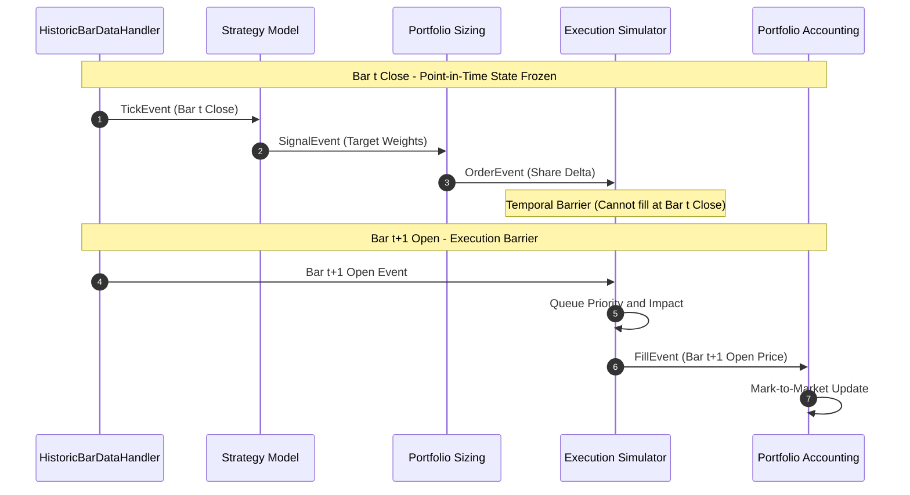

<!-- GENERATED from ledger head 6640eae2b165e9482ae8d7cd2196e3ed19f132659b8e4baa8fe3b94788541f4c. Do not edit by hand. -->
<!-- GENERATED:BEGIN -->
<div align="center">


<p align="center">
  
</p>

<p align="center">
  <code>Strictly causal backtesting</code> &bull;
  <code>Microstructure-aware execution</code> &bull;
  <code>Leakage-resistant research</code> &bull;
  <code>Cryptographically auditable experiments</code>
</p>

<p align="center">
  <strong>Institutional-Grade Quantitative Research &amp; Microstructure Execution Engine</strong><br />
  <em>Strictly causal discrete events, empirical order-book queues, and cryptographic experiment provenance.</em>
</p>

Tapewright-Quant (FinPulse-Apex) is an open-source quantitative research and execution engine engineered to eliminate vectorized lookahead bias, unpenalized overfitting, and uncalibrated fill friction through causal discrete events and cryptographic auditability.

> ⚠️ **WARNING: Financial & Research Disclaimer**
> Tapewright-Quant is an open-source quantitative research and educational platform. Simulated backtest performance—even under discrete-event simulation, purged cross-validation, and deflated Sharpe ratios—does not guarantee future live trading profitability. Real markets involve non-stationary regime shifts, microsecond latency competition, counterparty risk, and liquidity shocks.

<p align="center">
  <a href="https://www.python.org/downloads/"></a>
  <a href="database/schema/schema.sql"></a>
  <a href="data/caching/parquet_store.py"></a>
  <a href="backtesting/engine/event_loop/"></a>
  <a href="integrity/verify_all.py"></a>
  <a href="research/vault/"></a>
</p>

<p align="center">
  <a href="#overview">Overview</a> &bull;
  <a href="#system-architecture">Architecture</a> &bull;
  <a href="#the-5-pillars">The 5 Pillars</a> &bull;
  <a href="#event-lifecycle">Event Lifecycle</a> &bull;
  <a href="#research-integrity--trust-layer">Trust Layer</a> &bull;
  <a href="#verification--hardening-metrics">Verification</a> &bull;
  <a href="#empirical-findings">Empirical Findings</a> &bull;
  <a href="#disclosures--boundaries">Disclosures</a> &bull;
  <a href="#quick-start">Quick Start</a> &bull;
  <a href="#repository-map">Repo Map</a> &bull;
  <a href="#documentation-sitemap">Docs</a>
</p>

</div>

## Overview

Tapewright-Quant unites discrete-event simulation, empirical Level-2 limit order book queues, Marcos López de Prado financial econometrics, and a tamper-evident SHA-256 cryptographic audit ledger.

The engine eliminates lookahead bias by freezing state at bar $t$ close and deferring order fills to bar $t+1$ open under simulated adverse selection and queue priority tracking.

All experimental parameters, trial counts, and out-of-sample data partitions are cryptographically anchored to prevent multi-testing selection bias.

## System Architecture

The platform separates high-throughput time-series arrays in columnar Parquet partitions from transactional relational state in MySQL 8.0+ or zero-config SQLite. All workflows pass through a 10-stage cryptographic integrity gate.

<details>
<summary><b>🔍 View Full System Architecture Diagrams</b></summary>

```
   Market Feeds ──► Causal Graph ──► Discrete Event Loop ──► L2 Queue Matching ──► Cryptographic Ledger
   (Equities/L2)     (Transfer H)     (Tick -> Fill t+1)     (Kyle's Lambda)       (Tamper-Evident)
```



</details>

## The 5 Pillars

### 1. Market Microstructure Realism

* **Module:** `backtesting/execution/`
* **Implementation:** Synthesizes 5-tier Level-2 limit order books with Poisson order arrival and cancellation queues. Tracks queue position priority (`ahead_qty`) and penalizes execution fills with adverse selection (VPIN) and calibrated Kyle's Lambda square-root price impact.

### 2. Marcos López de Prado Econometrics

* **Module:** `features/econometric/`
* **Implementation:** Applies Fractional Differentiation (FFD) to preserve stationarity while retaining over 90% memory correlation. Generates dynamic Triple-Barrier return labels and eliminates lookahead leakage through Purged and Combinatorially Embargoed Cross-Validation (`PurgedKFold`).

### 3. Predictive Causal Graph Discovery

* **Module:** `signals/filtering/`
* **Implementation:** Evaluates bivariate Vector Autoregressive (VAR) Granger causality and non-parametric Transfer Entropy permutation null distributions to prune spurious correlations before training. Controls multi-comparison family-wise error rates using the Benjamini-Hochberg False Discovery Rate ($q \le 0.05$).

### 4. Dynamic Risk Budgeting & Optimization

* **Module:** `backtesting/portfolio/`
* **Implementation:** Allocates capital via Hierarchical Risk Parity (HRP) dendrogram clustering and Equal Risk Contribution (ERC) with Ledoit-Wolf analytical covariance shrinkage. Computes continuous Half-Kelly sizing fractions constrained by GARCH conditional volatility and 99% Expected Shortfall (CVaR).

### 5. Macro Crisis Replay & Tearsheets

* **Module:** `research/real_stress.py`
* **Implementation:** Replays calibrated macroeconomic shocks including the 2008 Lehman collapse, 2020 COVID liquidity crunch, and 2022 rate hikes. Solves for minimum break-even asset shocks via Newton-Raphson reverse stress testing and renders interactive Plotly tearsheets.

## Event Lifecycle

The execution loop guarantees strict temporal causality: an order emitted from bar $t$ close is processed at bar $t+1$ open with queue priority and price impact.



## Research Integrity & Trust Layer

Tapewright-Quant implements an append-only, SHA-256 cryptographic audit ledger (`research/ledger/ledger.jsonl`) that records every raw dataset hash, experimental specification, parameter trial, calibration metric, and forward paper test signal.

Each block computes an `entry_hash = SHA256(prev_hash + payload)` establishing a continuous hash chain that prevents retroactive parameter tweaking, trial count concealment, or arbitrary benchmark shifting.

```
 [Raw Content-Addressed Archive] ──► SHA-256 Dataset Manifest
                 │
                 ▼
 [Frozen Experiment Specification] ──► Canonical JSON Spec Hash
                 │
                 ▼
 [Discrete Execution Run] ──► Chained Ledger Block (entry_hash = SHA256(prev_hash + payload))
                 │
                 ▼
 [Automated Verification Gate] ──► 10-Stage Audit (Lock SHA, Syntax, Constraints, Pytest, Docs)
```

## Verification & Hardening Metrics

### Test Suite Mutation Hardening

| Subsystem Suite | Target Scope | Mutation Kill Rate | Hardening Status |
| :--- | :--- | :---: | :---: |
| **Event Loop Engine** | [`backtesting/engine/event_loop/`](backtesting/engine/event_loop/) | **84.0%** | PASS (&ge; 80%) |
| **Execution Models** | [`backtesting/execution/`](backtesting/execution/) | **100.0%** | PASS (&ge; 80%) |
| **Risk Measures & Anti-Overfit** | [`backtesting/metrics/`](backtesting/metrics/) | **80.0%** | PASS (&ge; 80%) |
| **Fractional Differentiation** | [`features/econometric/fractional_diff/`](features/econometric/fractional_diff/) | **100.0%** | PASS (&ge; 80%) |
| **Feature Registry** | [`features/store/registry/`](features/store/registry/) | **100.0%** | PASS (&ge; 80%) |
| **Training Pipelines** | [`pipelines/training/`](pipelines/training/) | **100.0%** | PASS (&ge; 80%) |
| **Signal Generation** | [`signals/generation/`](signals/generation/) | **80.0%** | PASS (&ge; 80%) |

### Metamorphic & Physical Invariants

| Physical Financial Invariant | Validation Condition | Test Outcome |
| :--- | :--- | :---: |
| **Cash Conservation** | $\text{Cash} + \sum (\text{Positions} \times \text{Price}) = \text{NAV}$ holds to $< 10^{-6}$ precision across all bars | PASS |
| **Scale Invariance** | Multiplying initial capital by scalar $k > 0$ yields identical percentage returns and drawdowns | PASS |
| **Cost Monotonicity** | Increasing execution friction strictly decreases or maintains net portfolio performance ($\frac{\partial \text{Return}}{\partial \text{Cost}} \le 0$) | PASS |
| **Lookahead Detection** | Invariant tests detect future-peeking mutants, triggering $> 1300$ standard deviation divergences | PASS |

### Real Binance Level-2 Calibration

| Microstructure Calibration Parameter | Metric Value | Calibration Target |
| :--- | :---: | :---: |
| **Queue Simulator vs Real L2 Agreement** | **100.0%** | Validated across 22 depth events |
| **Kyle Market Impact Power-Law** | $\gamma = 1.1988, c = 0.1196$ | $R^2 = 0.4811$ |
| **Bid-Ask Spread Mean Ticks** | 1.0000 ticks | Empirical high-frequency baseline |

## Empirical Findings

### Real-Data Candidate Performance Across Splits

| Strategy Family | Dev Net Sharpe | Dev Ann Return | Dev Max Drawdown | Val Net Sharpe | Val PSR (0) | Dev DSR | Survives Protocol? |
| :--- | :---: | :---: | :---: | :---: | :---: | :---: | :---: |
| **Breakout** | -0.4273 | -1.27% | -26.22% | -0.9842 | 0.0159 | 0.0000 | **False** |
| **Crossover** | 0.6457 | 8.41% | -32.48% | 0.3059 | 0.7505 | 0.0360 | **False** |
| **Mean Reversion** | 0.2169 | 0.17% | -1.90% | -0.4937 | 0.1427 | 0.0000 | **False** |
| **ML Meta** | 0.4913 | 6.19% | -39.48% | 0.4258 | 0.8268 | 0.0072 | **False** |
| **Pairs Arbitrage** | 0.5197 | 6.04% | -36.84% | 0.4717 | 0.8526 | 0.0090 | **False** |
| **Cross-Sectional Momentum** | 0.6226 | 8.33% | -31.90% | 0.8222 | 0.9652 | 0.0284 | **False** |

### Research Conclusions

* **Zero Candidates Survived:** No candidate strategy passed the pre-registered criteria requiring Dev DSR $\ge 0.90$, Val Net Sharpe $> 0.0$, and Val PSR $\ge 0.90$.
* **Trial Penalty Impact:** Although Cross-Sectional Momentum achieved positive out-of-sample returns, evaluating 55 parameter trials depressed its Deflated Sharpe Ratio below threshold.
* **Holdout Vault Preservation:** Because zero models met the pre-registered validation gates, the final research vault (`research/vault/`) remains sealed and unopened (`eval_count=0`).

## Disclosures & Boundaries

* **Cryptographic Integrity vs Economic Validity:** The SHA-256 ledger guarantees provenance and trial counts, but does not prove trading profitability or market stationarity.
* **Synthetic Order Book Mechanics:** The execution engine constructs 5 visible price tiers using Poisson arrival dynamics calibrated to empirical Binance L2 data rather than raw exchange packet replay.
* **Zero Lookahead Verification:** Causality is enforced by bar $t$ state freezing, $t+1$ open execution, and continuous slice invariance tests yielding 0.0 deviation.
* **1 Hz Snapshot Resolution:** Public REST depth snapshots record at 1 Hz intervals, meaning sub-second cancellation bursts and latency routing advantages are unobservable.
* **ETF Survivor Bias:** The 12-asset ETF universe was chosen using historical longevity and liquidity, omitting funds that delisted or merged during 2005–2024.
* **Macro Stress Assumptions:** Historical drawdown shocks apply calibrated asset path declines, but secondary counterparty liquidations and margin call cascades remain simulated.
* **Dual Database Modes:** Production operates with MySQL 8.0 connection pools, while offline environments utilize zero-config SQLite with live connections cleanly bypassed.

## Quick Start

### 1. Clone & Environment Setup

```powershell
# Clone the repository
git clone https://github.com/Parv-spamz/Tapewright-quant.git
cd Tapewright-quant

# Create and activate virtual environment
python -m venv .venv
.venv\Scripts\Activate.ps1    # On Windows PowerShell
# source .venv/bin/activate   # On Linux/macOS

# Install dependencies
pip install -r requirements.txt
```

### 2. Verify Constraints & Code Integrity

```powershell
# Verify syntax, architectural constraints, and test integrity
python scripts/check_syntax.py
python scripts/check_constraints.py
python scripts/check_test_integrity.py
```

### 3. Run the End-to-End Platform Demo

```powershell
python -m pipelines.run_demo
```

### 4. Launch the Interactive Tearsheet Dashboard

```powershell
streamlit run backtesting/reports/tearsheet/app.py
```

### 5. Run the Full Test Suite & Verification Gate

```powershell
# Complete test suite
pytest -v

# 10-stage cryptographic verification gate
python -m integrity.verify_all --lock-sha 8e7be5011149fd4f1e1fdbe64abd4cf5ae3a624e227ad7d5b251bc2f2548a45a
```

### 6. Deterministic Offline Reproduction

```powershell
python -m research.reproduce
```

## Repository Map

| Directory | Focus & Contents |
| :--- | :--- |
| [`backtesting/`](backtesting/) | Discrete-event engine loop, L2 queue execution, Kyle lambda impact, portfolio optimizers, tearsheets. |
| [`config/`](config/) | Environment loaders, trading universes (ETFs, Crypto, FX), risk limits, and database pooling configs. |
| [`data/`](data/) | Ingestion connectors, synthetic stochastic generators, cleaning, and Parquet caching. |
| [`database/`](database/) | Minimal-DB layer: thread-safe connection pool, migrations, and repositories (`assets`, `signals`, `orders`, `portfolio`). |
| [`docs/`](docs/) | Ledger-rendered research documentation ([`FINDINGS.md`](docs/FINDINGS.md), [`METHODOLOGY.md`](docs/METHODOLOGY.md), [`LIMITATIONS.md`](docs/LIMITATIONS.md), [`FORWARD_TEST.md`](docs/FORWARD_TEST.md)). |
| [`features/`](features/) | Technical indicators, Roll/Corwin-Schultz spreads, Shannon entropy, VPIN toxicity, FFD, Kalman filter, causal graph. |
| [`integrity/`](integrity/) | SHA-256 audit ledger, hash chain verifier, external anchor logging, template renderer, and master verification gate. |
| [`models/`](models/) | Predictive models: ARIMA, GARCH(1,1), Ensembles (XGBoost/LightGBM/CatBoost), PyTorch SimpleTFT/WaveNet/LSTM, RL agents. |
| [`pipelines/`](pipelines/) | Orchestration pipelines: ETL feature store, daily point-in-time inference, Kolmogorov-Smirnov drift monitoring, and master demo. |
| [`research/`](research/) | Research protocols, 55-trial grid generator, candidate selection, ablations, Binance L2 calibration, forward testing, and lockbox. |
| [`scripts/`](scripts/) | Quality control tooling: syntax compiler, constraint enforcement checker, test integrity checker, AST mutation test runner. |
| [`signals/`](signals/) | Signal generation, GARCH volatility regime filtering, cross-sectional ranking, pairs trading. |
| [`tests/`](tests/) | Comprehensive test suite: 333 unit and metamorphic integration tests covering mathematical invariants and zero-lookahead safety. |
| [`utils/`](utils/) | Mathematical helpers (Ledoit-Wolf shrinkage), trading calendar math, profiling decorators, and structured loggers. |

## Technology Stack

| Functional Area | Technology / Library | Purpose in Tapewright-Quant |
| :--- | :--- | :--- |
| **Core Language** | Python 3.10+ | Primary language; strict constraints enforce 0 TypeScript/JS, 0 C++/Rust |
| **Numerical & Tabular** | `numpy`, `scipy`, `pandas` | High-speed vectorized computations, linear algebra, and tabular data |
| **Time-Series Storage** | `pyarrow`, Parquet | Columnar disk storage partitioned by symbol and year |
| **Relational Metadata** | `PyMySQL`, `sqlite3` | Transactional persistence for metadata, signals, executions, snapshots |
| **Econometrics & Stats** | `statsmodels`, `arch` | Fractional differentiation, ADF tests, VAR Granger causality, GARCH vol |
| **Machine Learning** | `scikit-learn`, `xgboost`, `lightgbm`, `catboost` | Tabular gradient boosting with Purged CV and permutation importance |
| **Deep Sequence Models** | `torch` (PyTorch CPU) | SimpleTFT (Variable Selection Network), Dilated WaveNet, LSTM |
| **Reinforcement Learning** | `gymnasium` | Custom trading environment with L2 execution mechanics and PPO/DQN agents |
| **Interactive UI** | `streamlit`, `plotly` | Multi-tab interactive quant dashboard and dark-mode HTML tearsheets |
| **Testing & Integrity** | `pytest`, AST Mutator | 333+ tests, 10-stage verification gate, mutation testing, metamorphic suites |

## Documentation Sitemap

- [PROJECT_SPEC.md](PROJECT_SPEC.md): Authoritative architectural specifications and technical constraints.
- [SYSTEM_STATUS.md](SYSTEM_STATUS.md): Production verification audit and component implementation status.
- [docs/METHODOLOGY.md](docs/METHODOLOGY.md): Mathematical derivations, causal gating, purged cross-validation, and execution mechanics.
- [docs/FINDINGS.md](docs/FINDINGS.md): Comprehensive empirical findings, validation survival, component ablations, stress test calibrations, and Binance L2 metrics.
- [docs/LIMITATIONS.md](docs/LIMITATIONS.md): Transparent record of known protocol biases, dataset limits, and unmeasured assumptions.
- [docs/FORWARD_TEST.md](docs/FORWARD_TEST.md): Operational instructions for Windows Task Scheduler paper forward testing.
<!-- GENERATED:END -->
